# Cartomancy

> *Magic in retrograde.*

 [@altwof](https://x.com/altwof)

<table>
<tr><td>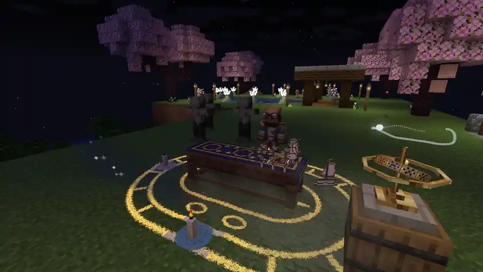</td><td>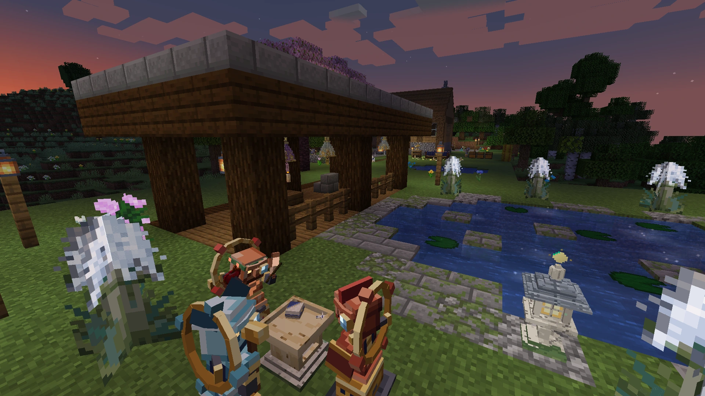</td></tr>
<tr><td><em>The Star's picture unfolds into a little paper theatre over the cloth.</em></td><td><em>Dusk at a full Moon in the Moon Garden. Jacks hold the goods up at the offering plate, and the Stone Lantern keeps watch by the pond.</em></td></tr>
</table>

**Cartomancy** is a celestial magic and divination mod for Minecraft, targeting **1.20.1 through 26.3** across Forge, NeoForge and Fabric. Built with [Mycelium](https://github.com/worflor/mycelium), its compatibility toolkit. The sky is a clockwork of twelve Houses, seven Wanderers and eight moon phases that runs on the world's own clock, and it decides how strongly each of the 78 cards of the tarot speaks.

You are the Fool, setting out with nothing. Find cards, learn to read the sky and cast them as spells in the field. Lay spreads to read for friends, keep a garden for your little paper guests and wake old clockwork jacks to sort your cellar. Eventually, you can step into a world of your own inside a glass globe.

It's a seriously unserious scholarly craft of reading the world itself: the sky is exact, the readings are true, and the soup tastes of wet paper.

*Unreleased. Development centres on Fabric 1.21.1; other targets are being ported.*

Want to follow along? **Star** this repository to keep it handy, or **Watch** it for updates (choose **Custom → Releases** for build notifications).

## What it is

- **A sky you can read.** The Almanac shows the 96-day Great Year ahead, so an eclipse or a favourable House is something you can prepare for. Everyone on the server shares the same sky.
- **Cards that hear it.** The Moon, the House and your surroundings decide a card's favour, from Fallen to Exalted. Its next Cut is shown before you cast; a timed second press, the Catch, can turn it towards the face its paper intends.
- **Tactile cards.** A dropped card lies flat, face up or face down for everyone to see. Paper, leaf and wear follow it from face to back. Bring a card to the scene in its picture and it can remember the place and who was there.
- **Honest divination.** Deal from your Folio at the Reader's Table and a friend's cut makes them the subject: a Sword asks where an unvisited place lies, a Cup asks about the weather. The reading says when it was true.
- **The home practice.** A Moon Garden gives paper Star Guests somewhere to teach. Their six lessons lead from the cat beside the pond to the card she can keep, and from your pickaxe to the working tucked into it.
- **The workshop.** Draw a Keep round the cellar and the clockwork jacks sort goods by what the stores hold. Their Wanderers give them trades: Sol serves the forge, Venus tends animals, Saturn reaps and mends.
- **Stormglass.** Prepare sand beneath a lightning rod, answer the House's figure and wait for the storm. Brush away the sand to uncover branching glass, ready for building or working into a card's finish.
- **The kitchen.** A spare card can become four bowls of Cardboard Soup or three Steeped Tinctures. Chariot Soup speeds a horse; Tower Soup gives an explosive burp. A potato in the pot improves the prospect of eating it.
- **The Living Codex.** Collect all 78 cards and the Grand Reading tells your journey back: the first card found, the one most played, the shadows you used. The Folio becomes the Living Codex, keeping the cover and pressed flower you gave it.

Start wherever you're curious: [the sky](docs/the-sky.md), [the cards](docs/the-cards.md), [the table](docs/the-table.md), [the Moon Garden](docs/the-moon-garden.md), [the workshop](docs/the-workshop.md), [the Snowglobe](docs/the-snowglobe.md) or [the Fool's journey](docs/the-fools-journey.md).

<table>
<tr><td>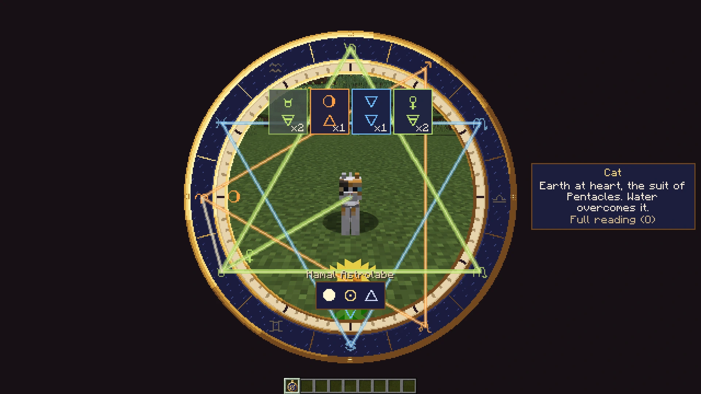</td><td>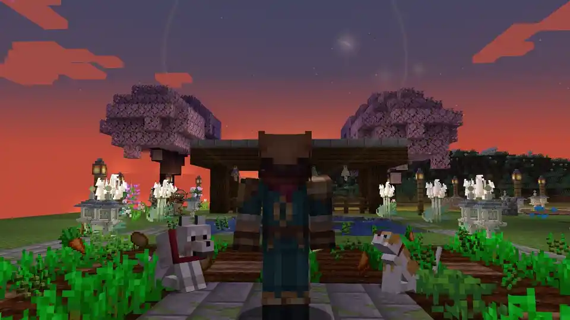</td></tr>
<tr><td><em>The Astrolabe raised at a cat: its birth chart drawn over the world, and a line of temperament.</em></td><td><em>The Sun answers the sky and brings on the crops.</em></td></tr>
<tr><td>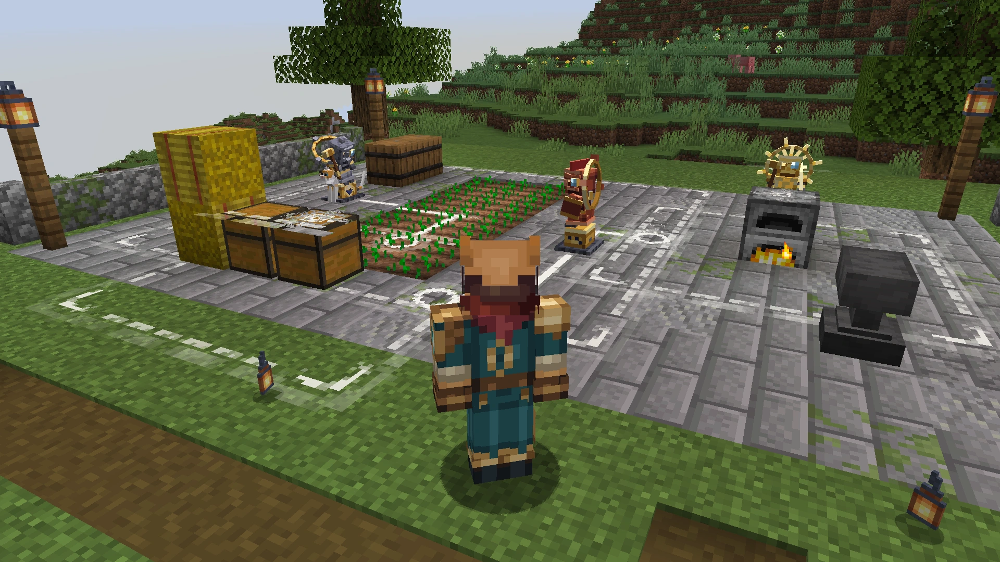</td><td>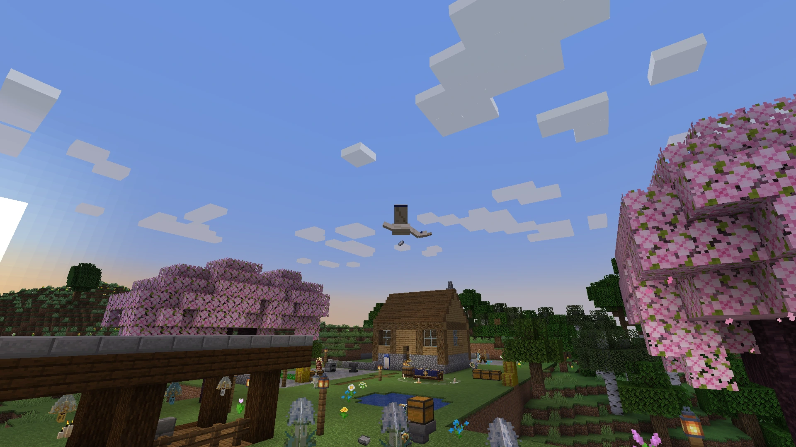</td></tr>
<tr><td><em>The jacks' yard: one reaps the wheat, one minds the furnace, one waits at the anvil, and chalk marks show them where things go.</em></td><td><em>A paper crane lifts a parcel of iron off the bank, bound for a jack at the far end of the world.</em></td></tr>
<tr><td>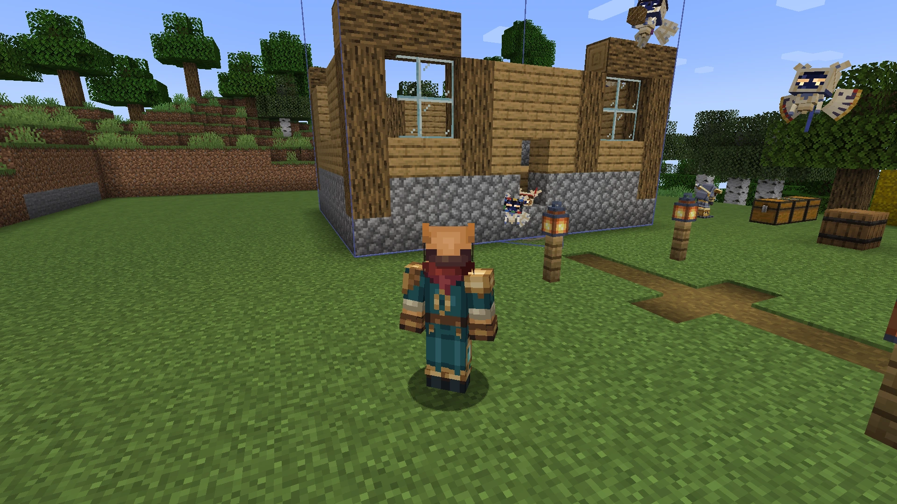</td><td>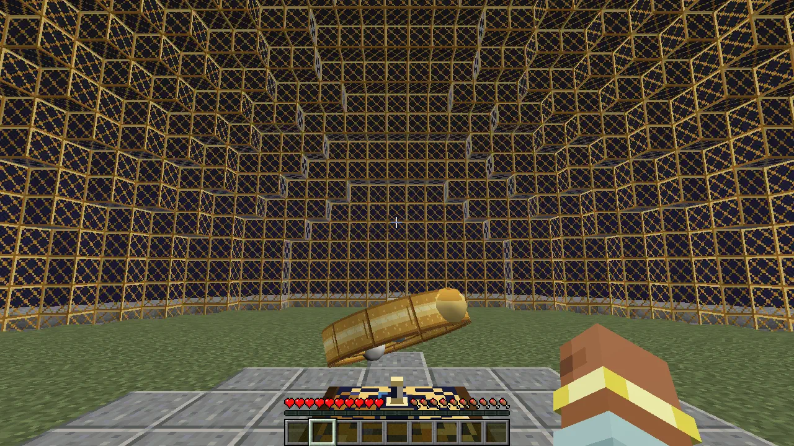</td></tr>
<tr><td><em>The household raises a cottage from a plan, block by block, while its reader watches.</em></td><td><em>Inside the Snowglobe: a terrace beneath its glass.</em></td></tr>
<tr><td>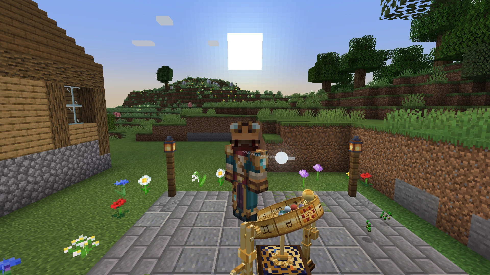</td><td>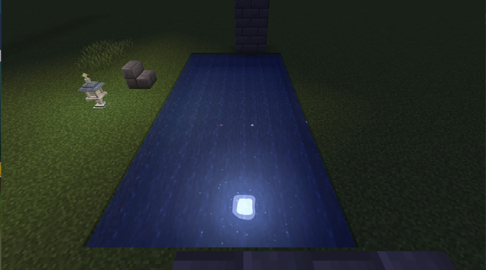</td></tr>
<tr><td><em>Standing on the rim of the brass Orrery, with the real sky turning on its bands.</em></td><td><em>The Moon and active constellation reflected in the Moon Garden pond.</em></td></tr>
<tr><td>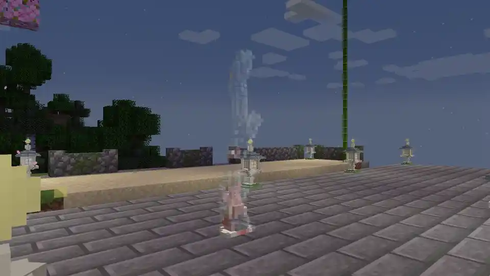</td><td>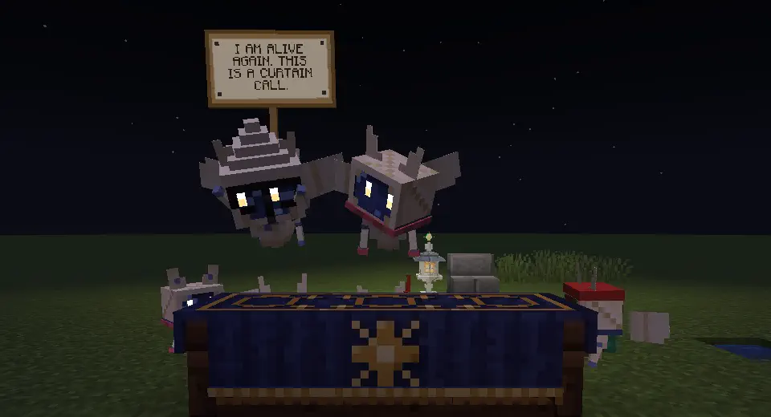</td></tr>
<tr><td><em>Lightning glass in the colours of the Houses.</em></td><td><em>The household takes its bows after <i>Romello and Jonliette</i>.</em></td></tr>
</table>

More of the game, as it looks in play, is in the [gallery](media/README.md).

## Licence and provenance

All rights reserved except the historical illustrations: Pamela Colman Smith's 1909 Rider-Waite-Smith, the Sola Busca (1491) and Yoshitoshi's *One Hundred Aspects of the Moon* are public domain. The Numbers uses original artwork. Third-party decks declare their own provenance.

## Music disc

***In Good Company***, by **woflo**, is the graduation music disc. [Listen to the disc](media/music/in-good-company.ogg); feedback is welcome.

*"Tomorrow there is good work to do, but tonight there is good company."*
