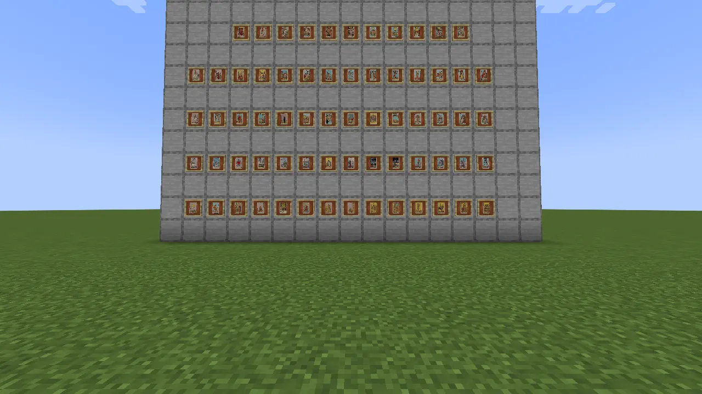
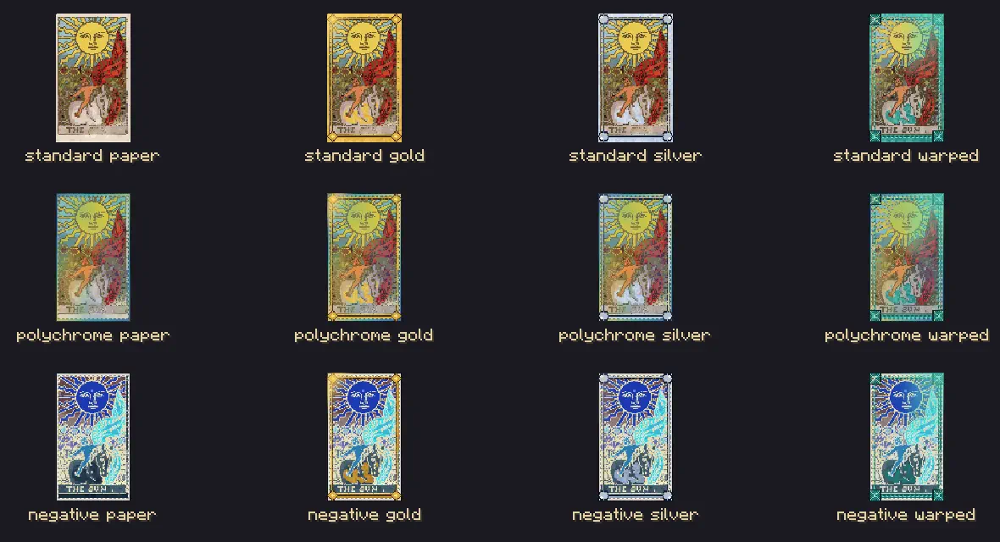
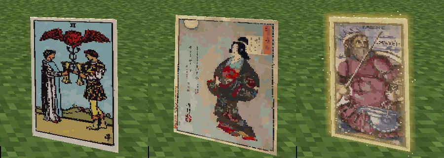

# The cards

*Seventy-eight cards, and every one of them is doing something.*

## Read the picture

Pamela Colman Smith's 1909 Rider-Waite-Smith illustrations are the spellbook. The **Fool** steps off a cliff: cast him and you leap along your gaze, safe from falling until you next touch ground. The **Hanged Man** suspends you, unable to act but safe from harm; when you come down, your wet cards are nearer to drying. The pause earns its keep.

The **Tower** brings down blocks where you look, with drops and no fire. Its reversal, **Averted**, protects a place against explosions for five minutes, but also stops you breaking blocks there. A reversal is the same scene seen from its other side, with its own use and its own inconvenience.

Those are Majors: 22 cards with large, particular workings. The other 56 are Minors, divided into four suits: **Wands** (Fire), **Cups** (Water), **Swords** (Air) and **Pentacles** (Earth). Their ranks give you patterns to recognise across suits, while their pictures keep each working particular. Try a Wand before mining, or a Cup when a companion needs healing.

## Ink, stance and the Cut

Casting never consumes the card. A used Minor is **Spent** while its ink dries; a Major has its own rest. The card shows when it will be ready. Different suits make a working rack: a field cast brings wet Minors of other suits nearer to drying, so changing your tools has a practical reward.

Choose **Balanced** for the ordinary cast. **Careful** gives up a step of favour for a certain upright reading. **Bold** adds a step and gives either face equal odds. It costs **15 experience points**, not 15 levels.

The **Cut** decides which face lands. It is dealt ahead, and the card shows what would happen under the current sky and stance. A card dealt against its paper's intention sits turned in your hand with an ember at its edge. Change the circumstances and its foretold face can change too; studying it spends nothing.

When such a cast begins to turn, a bell and creak give warning. A needle sweeps through a dial at the crosshair. Press cast again within its gold arc to make the **Catch**. A successful Catch asks a longer rest of the card. The practice dial lets you learn the motion without paying for a spell.

Sometimes keeping the reversal is the better judgement. Reversed **Death** briefly refuses death to everything nearby, enemies included. It can save a friend and spoil your own finish in the same breath.

## Paper with a history

Cards lie flat where they fall, face up or face down, with everyone seeing the same side. Their deckled edges acquire wear: **Mint**, **Played**, then **Battered**. Still water washes them down through those conditions to a blank; running water leaves a stream sorter safe.

*A collection on the wall still answers the sky.*

Paper and leaf are separate choices. **Standard** is the ordinary paper. **Polychrome** comes with eclipses and the Great Conjunction and reaches further. **Negative**, found in the Nether or End, favours the reversed face more surely as the sky improves. Its Catch turns it towards that shadow.

Gold leaf strengthens a working and lengthens its rest. Moon-silver shortens the rest and makes the other face more likely. Warped leaf silences the moving sky's terms, good and bad. The finish you want depends on the spell and the sky.

*Three papers, each bare, gilded, silvered or warped: twelve finishes.*

The deck changes the art and can change how a card hears the sky, while the spell remains its own. **Sola Busca** listens more strongly to planetary terms. Yoshitoshi's **A Hundred Moons** supplies another set of pictures to linger over.

*Three ways of carrying a picture.*

## Finds, copies and dinner

A cartographer sells a Battered Fool for an emerald. Fishing, treasure and exploration bring other cards. A **blank card**, made from paper and an ink sac, gives you another beginning: the Astrolabe can print a Battered Minor from a place or creature. Sleep with a blank in your off hand and a dream can write on it; the morning's account tells you why.

A spare card can stay in your Folio, go into a spread or be used in an offering. If you'd rather cook one, a heated water cauldron, a card and four bowls make **Cardboard Soup**. Chariot Soup can speed a horse; Tower Soup produces an explosive burp without harming the building. Season the simmer with potato, carrot or honey to spare the drinker Cotton Mouth. A brewing stand turns a card into three **Steeped Tinctures** instead.

For work that needs more than one picture, there is [the table](the-table.md).
