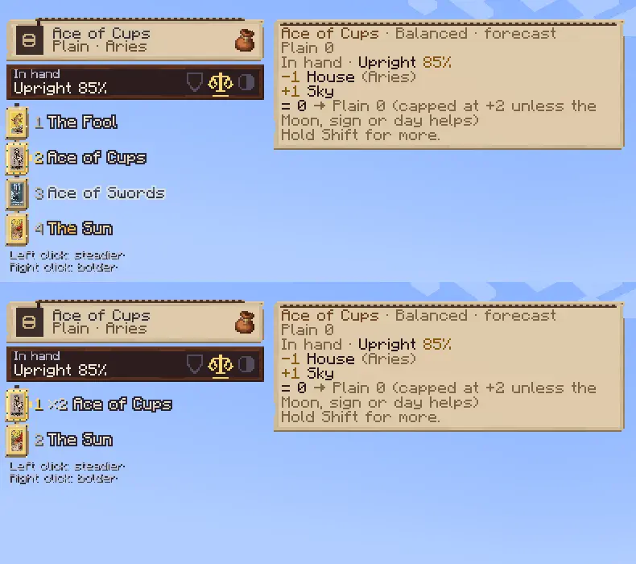
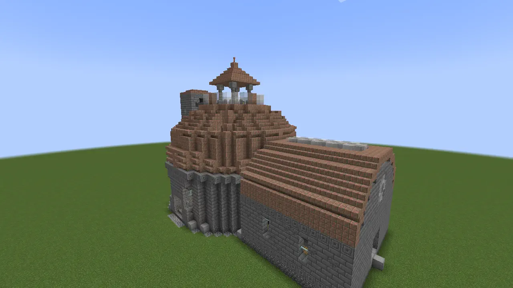
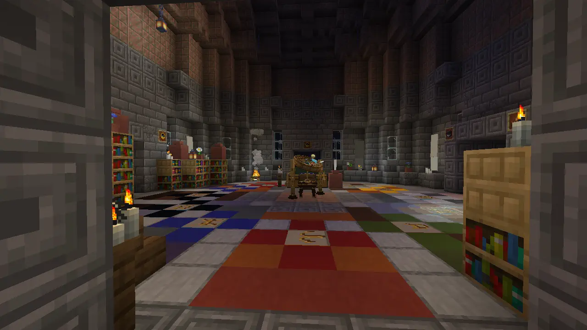
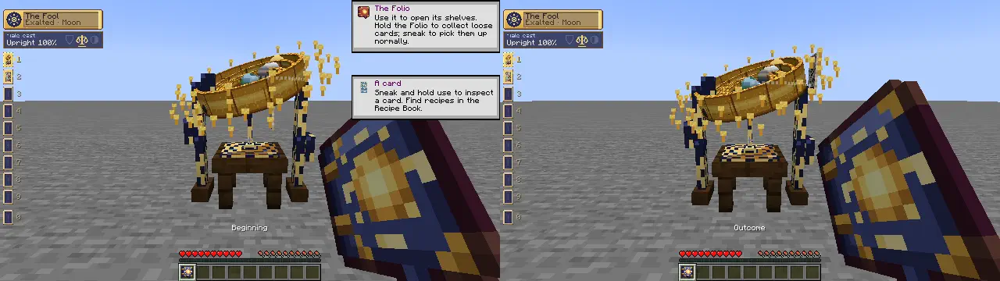

# The Fool's journey

*The journey is a shape. You supply the detours.*

## Card zero

The Fool is numbered **0**: a traveller at a cliff edge, eyes up, with a white dog at his heels. His journey through the Majors ends with the World. In Cartomancy you are that traveller, whatever happens to be in your hand first.

A village cartographer sells a Battered Fool for an emerald. The Fool's leap is worth trying somewhere with a proper drop. But a Cup from fishing, a Wand from a temple or a blank you write on yourself is an equally proper beginning. The collection has no required first card.

A vanilla **bundle** is enough for a first casting kit. Pack cards alongside your other goods and select them without emptying the bag.

The **Folio** gives those finds a binding of their own. Find one in an Observatory or stronghold library, or offer a book, leather and a gold nugget in a ready Moon Garden. Held in either hand, it gathers loose cards; in a pocket it remains available to your rack without quietly taking every pickup. Its library distinguishes decks, papers and leaves, so a familiar Sun in another finish is still worth a second look.

*A makeshift Folio, with room for other things.*

## One possible afternoon

You come back from the river with a Cup and enough paper for a blank. Raise the Astrolabe at the ground and see what kind of card the place can write. At home, set three tables together, put your cards on the runner and move them until the study says something useful.

You can do all this before meeting a Star Guest. Later, when the Quire teaches you the table, it recognises what you've already worked out. The six home lessons connect your pet, your tools, your garden, the sky and your friends to the same collection.

One reader fills a Folio by travelling. Another learns a few cards well enough to tend a field and a workshop. Neither has to play through the other's itinerary.

## A collection you use

The library keeps a separate place for each paper and leaf, with a ghost in an empty cell explaining how that finish is found. Your first Sun might be Battered. Later, you might find it on a different paper or lay gold leaf onto it. Gold gives a stronger working with a longer rest; on casts that draw a Cut, moon-silver gives a shorter rest and a less obedient face.

Try that choice against an ordinary task. A card you want for one large intervention can bear a different finish from one you want ready repeatedly during an evening. Keep both in the Folio and study their quotes under the same sky. After a few experiments, you'll know which copy you want in your rack.

The **Commonplace** keeps those experiments. Compare an observation with what happened, or choose a coming sky and cast in it. Keep a useful method with your own title and note, then copy it onto a Cartouche for a friend to try.

## The scholars' hills

**Observatories** stand in thirteen kinds: the twelve Houses and the **Open House**, which belongs to none. Their domes, chart rooms and bell lofts make them recognisable from a distance. A House's library favours its ruling Major; its archaeology leans towards its suit. The Open House keeps a more general collection.

*Grey stone, a copper dome, a bell loft and an annex.*

Take a brush as well as a bag. Battered cards and suit fragments in the chart room are another reason to linger after opening its chests. The seized jack in the loft offers a different question: why does its dial point to that hour?

*The chart room after dark.*

The **Astronomer** is a villager with an Orrery for a workstation. It mends cards, buys duplicate Majors and sells the world's card of the day. An Orrery also lets you mend with paper, ink and experience. A Battered favourite need not be replaced simply because a cleaner copy turns up.

## The collection reads back

When the Folio's shelves hold all **78 tarot** card slots, it is ready for the **Living Codex** ceremony at an Orrery or Reader's Table. Any tarot printing, paper, leaf or wear counts. Cards entrusted to a familiar or tool count too; cards left in a chest do not.

The **Grand Reading** tells your actual history in six positions.

- **Beginning:** the first card found.
- **Trial:** the first reversal caught or kept.
- **Counsel:** the card most played.
- **Shadow:** the shadow most used.
- **Choice:** the first named recipe discovered, contrary laying or working foreseen.
- **Outcome:** the last card found.

Cards sharing a position rise together. A position with no history is left out.

*The first card and the last, with your practice between them.*

Your Folio becomes the **Living Codex**, retaining its chosen cover and pressed flower beneath gilt corners and a radiant boss. It returns on death and cannot burn. Its World can briefly hold movement and incoming damage still nearby; its Fool can be prepared as a rescue from a fatal blow. And you can still take the Codex out on your next journey.

For the practical questions that arise along the way, there is the [FAQ](faq.md).
