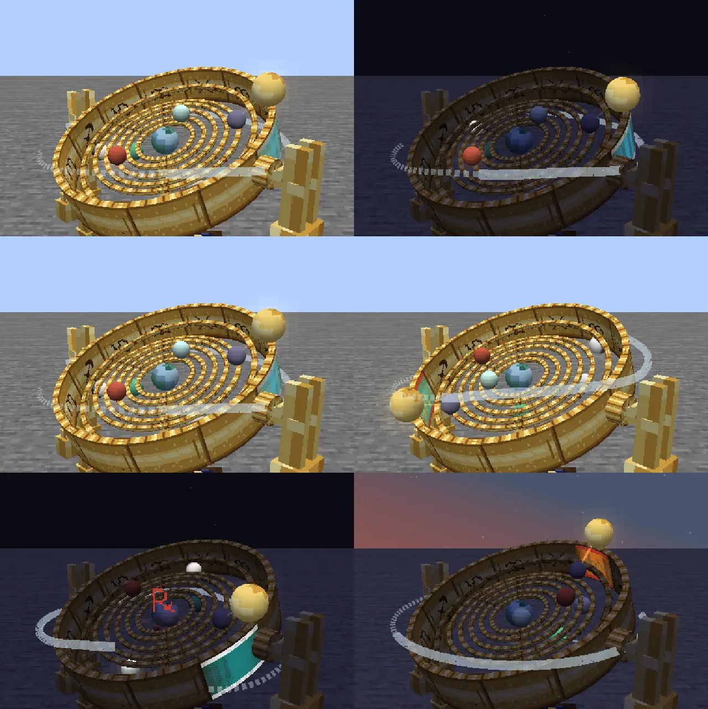
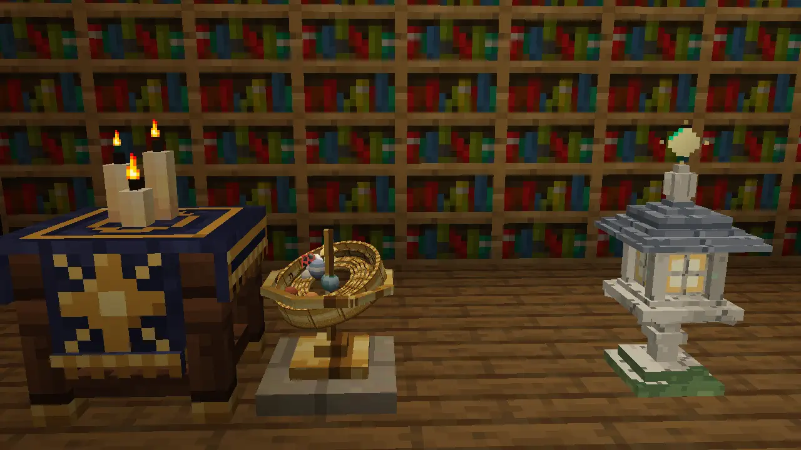
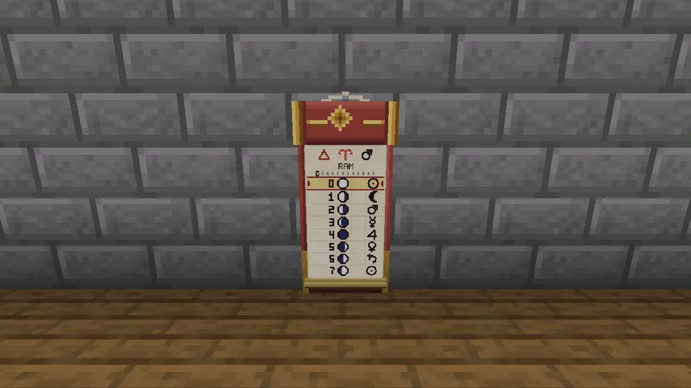

# The sky

*Look up. The sky keeps appointments, even when you do not.*

## Three wheels

Cartomancy's **Great Year** lasts ninety-six Minecraft days: about thirty-two hours if every day runs its full length. Twelve Houses take eight days each, and the passage from one to the next is a **Turning**. The Ram gives way to the Bull, then the Twins, and so round to the Fishes. Each House has an element and a ruling Major card.

The seven **Wanderers** give the week its days: the Sun, the Moon, Mars, Mercury, Jupiter, Venus and Saturn. A day also has eight **Watches**, from Dawn through Forenoon, Midday and Afternoon to Dusk, Evening, Midnight and the Small Hours. Their planetary rulers make an hour worth noticing as well as a date.

The Moon completes its eight phases in eight days. Since a House lasts just as long, each opens on a Full Moon. A new world begins on a Sunday, under that Full Moon, in the House of the Ram. The weekday wheel keeps turning across the year's end, so the next Ram need not open on a Sunday.

The sky is calculated from the world's clock and seed. Everyone on a server shares it, and the Almanac can show it ahead. You can make an arrangement for Mars's day with reasonable confidence that Mars will attend.

## What a card hears

Six laws give a card its **favour**. The Moon lifts Fire and Air Minors while waxing, Water and Earth while waning; Full and New Moons lift Majors. A House favours Minors of its element and opposes their contrary element, while its ruling Major has a season of its own. A Wanderer's Major answers to its weekday.

The other three laws concern your surroundings: the ground beneath you, whether the sky can see you, and the company a card keeps beside it in a spread. Wands find home in deserts, Cups by water, Swords on high peaks and Pentacles in the depths. Clear glass lets the sky through. A roof costs the open-sky bonus; it does not forbid casting.

The names on the cards are **Exalted, Favoured, Plain, Ashen and Fallen**. Favour changes a spell's strength, reach or duration. Exalted also opens the card's particular flourish, and needs help from the moving sky: good ground and a well-furnished practice cannot supply that on their own.

Take a Two of Cups under a waning Moon, in the Fire House of the Ram, on neutral ground beneath open sky. Its working includes a kindness from the Moon, opposition from the House and a kindness from the open sky: `+1 −1 +1 = +1`, Favoured. The explanation is called the **Because**. It tells you what mattered, so moving to the river or waiting for another House becomes an informed choice.

## When the wheels disagree

Mercury has one Retrograde window in each Great Year. Affected cards wear **℞**, and their foil sweeps backwards; the planet's bead reverses on the Armillary. Retrograde changes how those cards hear their planetary terms. The mark is worth reading before you cast.

There are two eclipses in a Great Year, named ahead in the Almanac. An eclipse can bring the Sun and Moon cards to Exalted. On the year's last day, the **Great Conjunction**, negative favour terms are waived. An eclipse is a good time to take the Sun and Moon out of the Folio; a Great Conjunction may make you rethink the rest of your rack.

## Brass, paper and light

The **Astrolabe** reads what you point it at: a card, a creature, a place. The desk-sized **Armillary Sphere** and floor-standing **Orrery** put the moving sky into brass rings and planetary beads. The day's Wanderer shines, and a Retrograde carries its own mark. Strike the Orrery and its brass answers in the current House's musical mode. You may also stand on its rim; scholarship need not always be conducted from the floor.

*The day's and the Watch's Wanderers shine on the Orrery.*

The **Wall Almanac** has twelve leaves, one per House. Turn a leaf with an empty hand and it rolls into its header; today's row is picked out in gilt. A wall of framed cards gives a less formal calendar: gold where the sky favours them, ash where it does not.

*A small sky for the study. Two Wanderers walk backwards.*

*Eight days on the Ram's leaf.*

The sky supplies the occasion. [The cards](the-cards.md) supply the scene.
