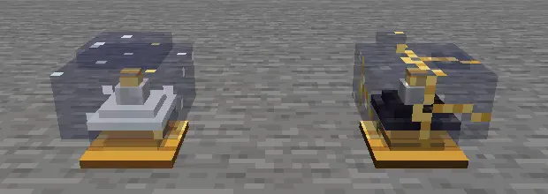

# The Snowglobe

*The tradition requires a crystal ball. This one has a small observatory in it.*

## Looking in

The **Celestial Snowglobe** has a brass foot, leaded glass and snow round a little building. Make one from an ender pearl, four glass and four amethyst shards. Held, it is an instrument for **scrying**. Placed, it is a door.

Shake it with a card in your other hand and the snow settles into a sky that suits that card where you stand. Keep use held and turn the wheel to look through the Great Year, a day per notch, with the card's favour and the Because beside the glass.

The globe uses the ground beneath you now, open sky and no company for its forecast. It doesn't know whether you'll still be beside this river next Tuesday. Move into a cave and ask again; the ground changes the answer.

Before an expedition, scry a Cup beside the river, find a favourable date, then check it again at the mine. You can compare the two readings without spending its ink. Scrying casts nothing, draws no Cut and changes no fortune.

## Your thread

With no card in the other hand, the glass shows the coming House and tomorrow's card of the day. It also lets you follow your **thread**: fortune as a line through your own lived time.

Your present place on it is your **tide**, named **Ebb, Low, Slack, High** or **Flood**. It leans the quality of finds and other fortunate outcomes. It does not decide whether a cast reverses; the card's Cut has that job. Good deeds do not fill a luck meter.

A placed globe wears its keeper's thread above the glass: the last nine days solid, the next three faint, and a bright bead at the present. Indigo deepens at Ebb; the line runs through teal and moon-silver towards gold at Flood. The future is visible for a little way, not for ever.

The shared sky follows world time; your thread follows the time you've actually played. You and a friend can share an eclipse without being at the same point in your fortunes.

## Stepping in

Sneak-use the globe on a block face to place it. Use it again to enter your **sanctum**, a terrace under glass in the **Firmament**. The sky is clear and open. The garden, table and furniture you bring make it a home.

*Inside the globe, at Astral Ward.*

The brass dial sets the boundary.

- **Eclipse:** opaque glass; nobody enters or looks in.
- **Astral Ward:** clear glass; visitors can admire the terrace from its outer balcony.
- **Welcome Feast:** the dial admits your chosen company inside.

At Welcome Feast, a friend can use your globe while you are home without owning one themselves. Bring a table, a jukebox or a cauldron of Starlight Chowder and the terrace has the makings of an evening.

Use the terrace's lodestone to return to the spot where you entered the globe. Sneak-use it for the road of starlight instead; the way home remains there when you want it.

At an Orrery you can give the sanctum a **star sign**, choosing a House you have visited. Its terrace becomes home ground for that element. A new sanctum is **Open**, with no House of its own. The sign gives you a useful choice of home ground while the moving sky remains everyone's.

## Glass and good custody

The placed globe belongs to its keeper. Carrying it safely takes Silk Touch and a toll in experience points. Its wool cushion or carpet can travel with it: a small courtesy to anyone who has already matched the room.

Breaking it without Silk Touch **shatters** it. The cracked globe remains, the sanctum seals and its contents stay where they are. It does not pour a household onto the floor. Pick up the shattered globe with Silk Touch and use it on an Orrery to restore the home within.

*Cracked glass; a sealed home.*

Back outside, there are still cards to find. [Follow the Fool's journey](the-fools-journey.md).
