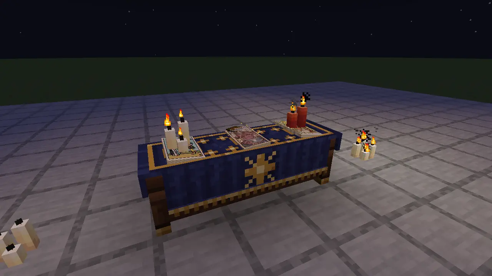
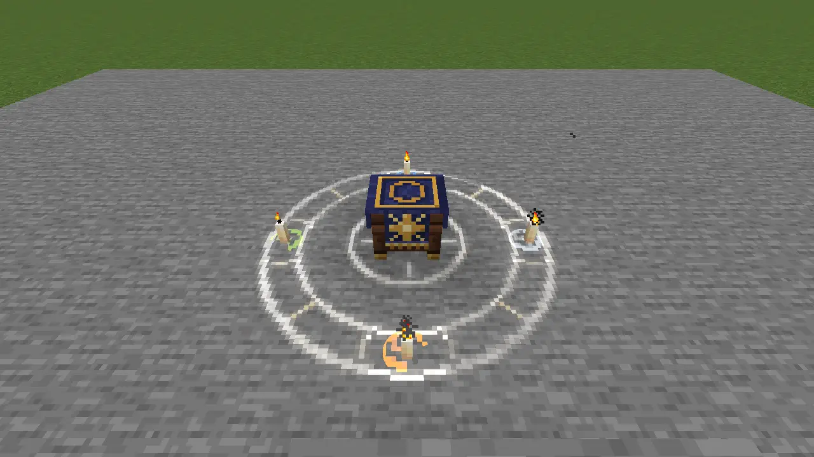

# The table

*Candlelight, indigo cloth. Lay a spell by hand, or deal a fortune and see what turns up.*

## A place to lay things out

The **Reader's Table** is aged oak with brass-shod legs and an indigo cloth stitched in gold. Wool or carpet changes the cloth's colour without taking away its gilt border. Tables placed side by side share one runner, with one card to each table.

A single card makes a **Quick Cut**. Three make the **Hourglass**, five the **Crossroads**, and ten the **Celtic Cross**. With three tables, moving just one card can change the whole working.

*The cloth gives each card its place.*

## Compose a spell

Cards laid by hand make a spell. In the Hourglass, the first is the **Reagent**, whose element meets the middle card's. The middle is the **Verb**, the working itself. The last is the **Vector**, whose rank decides how it reaches the world: perhaps a pair, a projected working or something delayed until the next Watch.

Suppose you want the middle card's spell but a different delivery. Leave it where it is and change the last card. The study changes with it. Now change the first and the elements meet differently: Fire and Water make steam. Three cards are enough to ask several sensible questions without casting anything.

While the cards lie there, **study** shows their favour, the reasons behind it, their Cut odds and the sentence the arrangement would read. Swap them, take one back, or turn one contrary. No ink is spent by trying a thought.

The reading begins when the table's owner knocks: sneak-use with an empty main hand. Cards turn in beats, with a gold countdown before the landing. Afterwards they remain as laid for another study. The table is a workbench with rather good cloth.

## Deliberately contrary

A card laid **contrary** resolves its reversed working for certain and rests twice as long. This is how you prepare the Tower's averted ruin on purpose. Its protection against explosions comes with the same restriction on your own building as it does in the hand; choosing a shadow does not remove its price.

A spread can be sealed into a **talisman** for one use in the field. Its inscription remembers the sky at sealing. A worse sky at firing can weaken it; a better one cannot make it stronger than its seal. Read the talisman's quote before trusting an old preparation.

Some arrangements are recognised by name as **compounds** or **concordances**. The cloth warms as you approach one you haven't discovered; bookshelves, candles and flowers sharpen different clues. Furnishing the study helps you understand the cards without strengthening the spell. Once you know a recipe, the table recognises it in study. Knowing a recipe doesn't stop you from trying the cards in your own order.

## Deal a fortune

A fortune begins differently: use your **Folio** on the table and it deals cards face down. You do not choose them. A friend can cut and become the querent, the person being read. Alone, you can read for yourself.

Each suit asks its own questions.

- **Swords:** where an unvisited structure lies, with direction and a distance band.
- **Cups:** the weather, or the land ahead.
- **Wands:** nearby threats, or the day's regional difficulty.
- **Pentacles:** recent deaths and uncollected experience, or Luck.

A second card of a suit asks its second question. A third admits it has nothing further to say. A Major asks both questions of its element. Better paper does not persuade the world to give a more flattering answer.

A direction can be confirmed in known land or predicted beyond it. Weather is reported under its current schedule. A reading says when it was true, and dealing again for the same subject within the Watch repeats it without another cost. The deck never lies; this includes saying what it cannot see.

Use paper to seal the reading into a **Cartouche**, carrying the cards and the lines as told. The Commonplace keeps readings too. A friend can leave with something more useful than your recollection of an encouraging Cup.

## The evening's other business

The chalk ring gives the table a visible boundary, with candles at its four points. It is also the chalk you take into the workshop.

*The reading has a place of its own.*

For an evening with fewer prophecies, **Card-Jitsu** deals each opponent a hand of five. Earth smothers Fire, Fire melts Air, Air cleaves Water and Water erodes Earth; otherwise rank and favour decide the round. Nothing is lost from your collection. The Astronomer or a villager you have traded with can take the other seat.

When the table is quiet, step out to [the Moon Garden](the-moon-garden.md).
