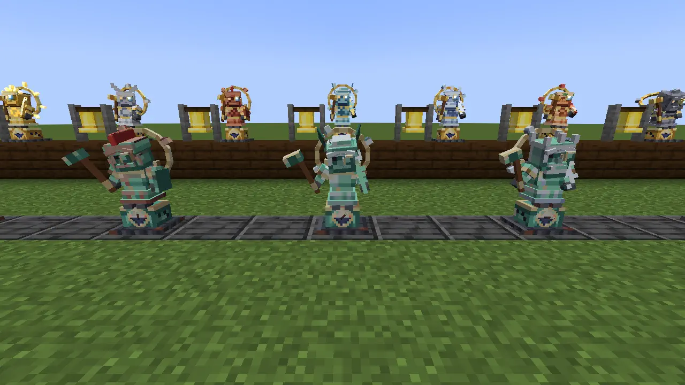
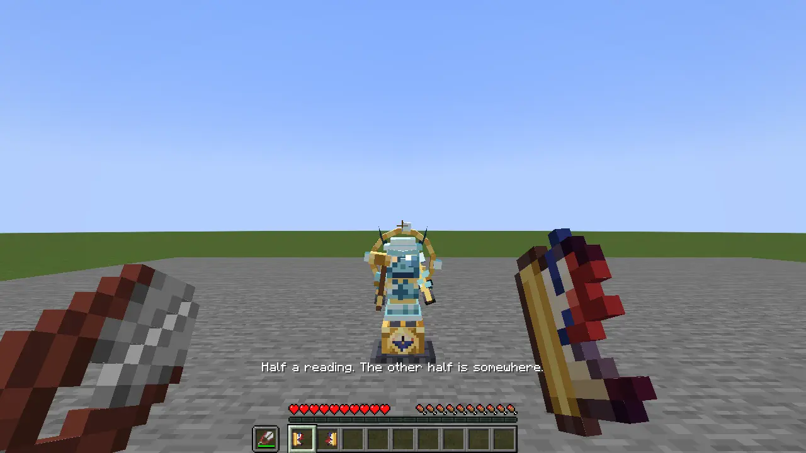
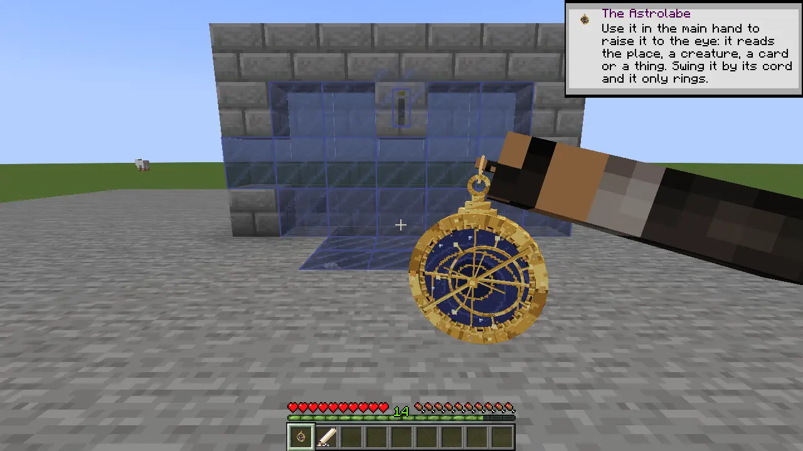
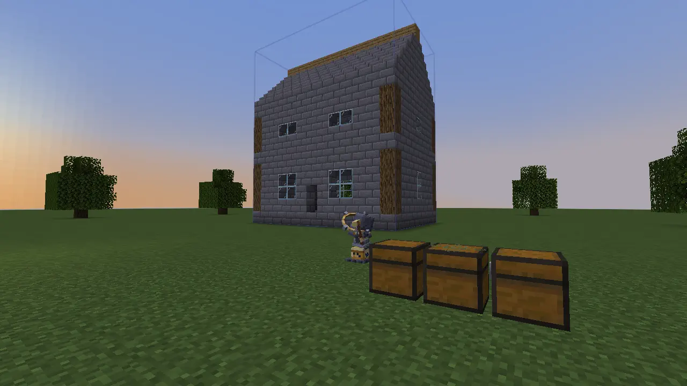

# The workshop

*Knock at the right hour and the old clock starts working for a living.*

## Seven trades in brass

A **jack of the Hours** stands on the case of its own clockwork, a little under a block tall. It carries a hammer, wears an astronomer's loupe and has a dial of the eight Watches beneath its feet. Its Wanderer's livery tells you its trade.

| Wanderer | The work |
|---|---|
| **Sol** | Serves the forge, with sunlight for the furnaces by day. |
| **Luna** | Carries fluids between vessels. |
| **Mars** | Works the anvil, beating leaf and crushing materials. |
| **Mercury** | Carries goods and tends the post. |
| **Jupiter** | Answers requests at a bell. |
| **Venus** | Tends animals: feeding, pairing, shearing and milking. |
| **Saturn** | Reaps fields and mends remembered damage. |

In an Observatory loft you can find one **seized**: green with verdigris, its hammer stopped mid-swing and dial fixed at Midday or Midnight. Strike it at the hour on that dial and it wakes. A fist works; so does the Astrolabe. At the wrong hour you get a clunk, which is a fairly complete answer.

*Verdigris in front; seven trades ready behind.*

You can cast a jack of your own from a clock, copper, gold and iron. The day chooses its livery: Tuesday makes a Mars. Awake, a jack strikes the Watches and works between them. Its own weekday doubles its pace. Retrograde turns its round backwards; an eclipse's deep stills its hammer.

## Tell it what this place is

**Chalk figures** name areas of work. A **Keep** is a cellar; a **Tend** is a field or pen; a **Make** gathers stations such as furnaces and anvils. The jack reads the things within that ground rather than needing an instruction for every chest.

Leave coal in one store and iron in another. Within the right figures, goods find the stores that want them. A chest of related things can express a broader wish, while an item frame makes a particular one clear. Emptying a store does not erase what it has learned to keep.

Try a small furnace corner first: a Make around the station, stores with recognisable contents, and a Sol to serve it. Feed it a mine's haul and watch what leaves each chest. Sol's sun-fire wants daylight and a keeper it has seen within the week; a furnace waiting for you is not asking for a new fuel.

Figures can wait for a condition, such as night or a planetary hour. Their lines show the distinction between waiting and working. Coloured chalk and matching caps separate jobs in a shared room. Start with plain chalk; colour becomes useful when there is actually something to separate.

A jack can work out where an ingot belongs. That doesn't give it permission to dig up your floor.

## The Crane Post

Shears divide a **Cartouche** into two halves. Give the halves to Mercury jacks at different bases and they become the ends of a postal route. One holds up the parcel, folds a paper crane and sends it away above the clouds.

*One reading, two addresses.*

A parcel travels a stack at a time at a bird's pace. Distance matters to the journey; it is correspondence, with time to put the kettle on. An unloaded destination keeps the delivery waiting until it can land. The receiving keeper must permit the post, so a friend's route is an invitation rather than a way into their cellar.

## A wall that remembers

Seal a place with a chalk **keystone** and the **Palimpsest** remembers blocks lost to misfortune: a blast, fire or an enderman's theft. It does not undo your own demolition.

Raise the Astrolabe at a remembered gap and its missing stones appear in indigo. A Saturn jack can lay them back from your supplies, from the ground upwards. If a creeper takes the garden wall, keep the rubble, provide what is missing and let the mason work.

*The old course of the wall, waiting for real stone.*

A chest comes back empty. Its contents belong to whatever happened to them in the blast; the memory cannot print another set. Stairs remember their facing, and signs their words. 

A **plan** gives a new building a similar outline and material bill. The Star Guests raise it block by block from the supplies in your stores. Check its position and the missing materials before letting them begin.

*The outline paid for in stone.*

## An exception in the loft

Some Observatory jacks are **Runaways**. They move while nobody looks, and a strike takes half your health. The Astrolabe warns you. Keep your eye on one and use a pickaxe; a friend who watches while you swing is particularly good company. Broken, it leaves parts and a jack that can finally have a keeper.

For a home with a more unusual boundary, there is [the Snowglobe](the-snowglobe.md).
