# Gallery

Scenes from the game while it's still being built.

## In the world

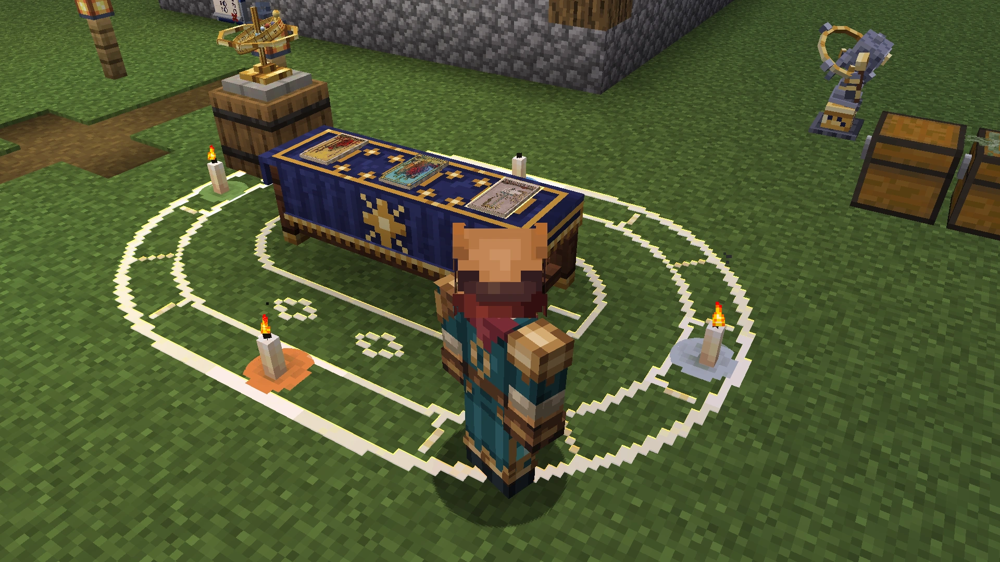
*A reading at sunset: three cards laid on the Reader's Table, inside a chalk ring with its four candles lit.*

*Dusk at a full Moon in the Moon Garden. Jacks hold the goods up at the offering plate, and the Stone Lantern keeps watch by the pond.*

*The Astrolabe raised at a cat: its birth chart drawn over the world, and a line of temperament.*

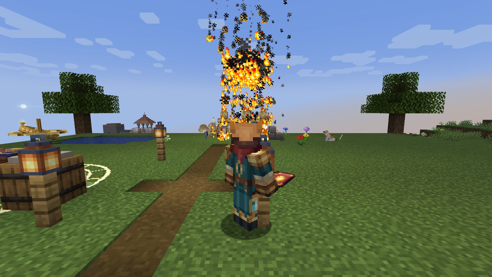
*The Eight of Wands, cast from the hand: a volley of flame comes down on three husks.*

*The jacks' yard: one reaps the wheat, one minds the furnace, one waits at the anvil, and chalk marks show them where things go.*

*A paper crane lifts a parcel of iron off the bank, bound for a jack at the far end of the world.*

*A cottage taking shape from a plan, one block at a time.*

*Standing on the rim of the brass Orrery, with the real sky turning on its bands.*

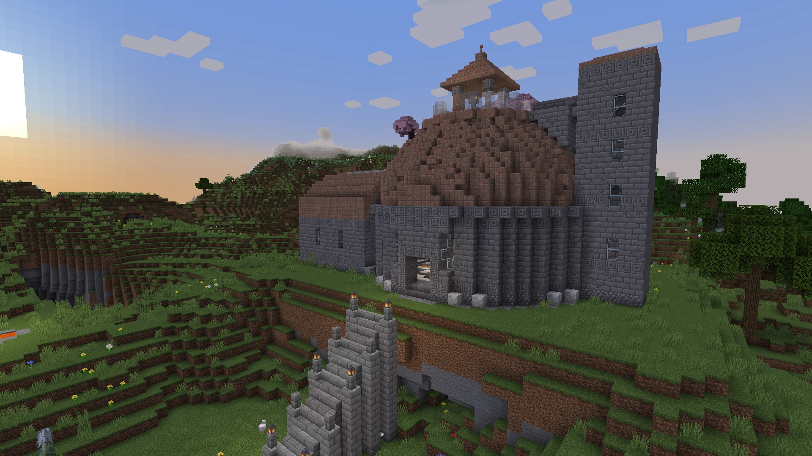
*A wild Observatory on a hill at golden hour.*

## The sky

*The Orrery reading the sky by colour, by day and by night.*

*An Armillary Sphere in a study, with a Reader's Table and a Stone Lantern. Two Wanderers are walking backwards.*

*A Wall Almanac open on the Ram's leaf, with today's row picked out in gilt.*

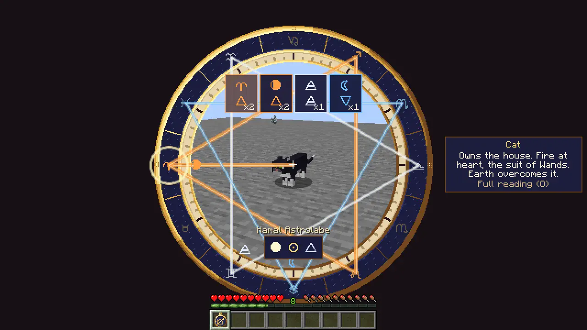
*The Astrolabe raised at a cat, its birth chart drawn over the world.*

## The cards

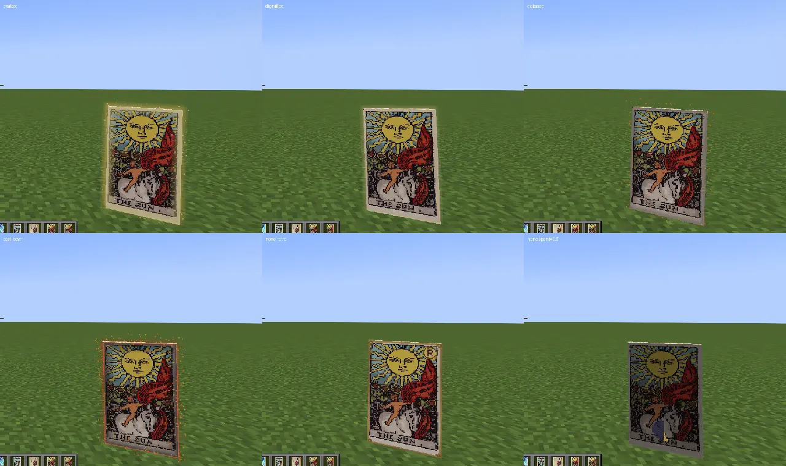
*The same Sun, from Exalted gold to Fallen embers, with Favoured, Ashen, Retrograde and half-Spent views beside them.*

*The Sun on three papers, each bare, gilded, silvered and warped: twelve finishes.*

*Three cards from three decks in the first-person hand: the base Two of Cups, a print of A Hundred Moons and a Sola Busca card.*

*All seventy-eight cards, one to an item frame.*

## The table

*A Reader's Table at night, candles on the cloth and cards laid on its stitched rings.*

*A Reader's Table in a closed chalk ring, its four candles lit.*

## The Moon Garden

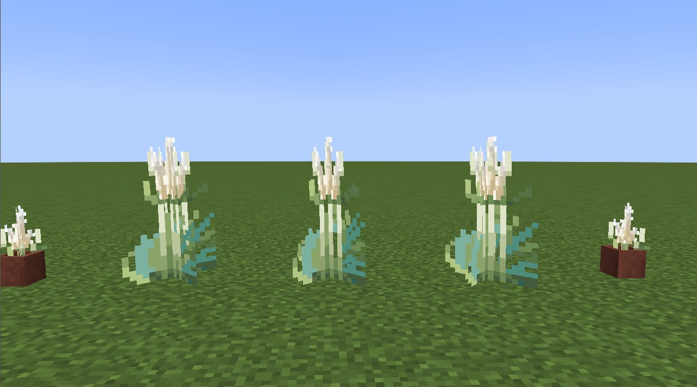
*Susuki by day, planted and potted.*

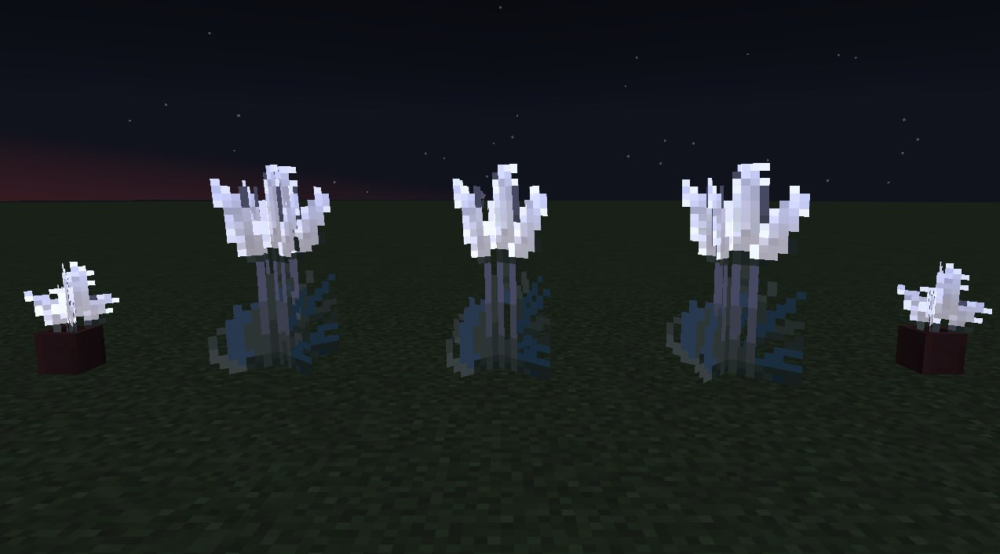
*Susuki at night.*

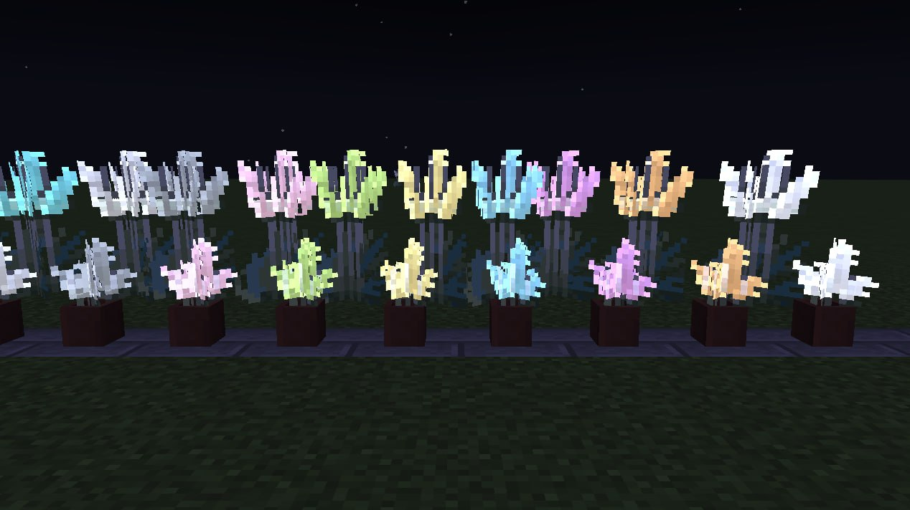
*Susuki in different colours at night.*

*The Moon and the active constellation in the pond.*

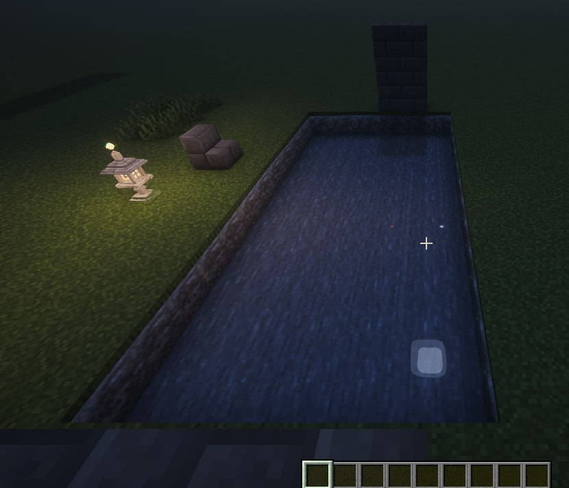
*The same pond with shaders enabled.*

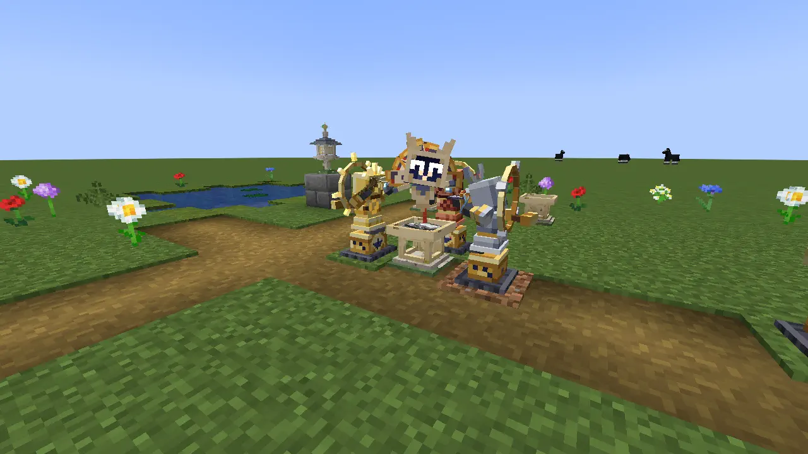
*An Offering Plate between two attendant jacks, a Star Guest behind it and a Stone Lantern by the pond.*

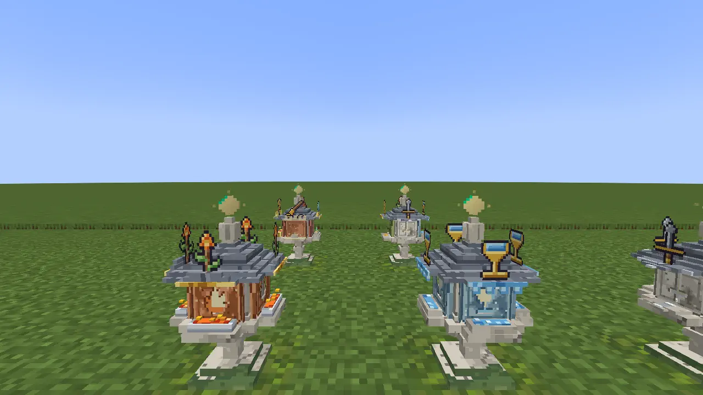
*A bare Stone Lantern beside lanterns dressed in clay for Wands and Cups.*

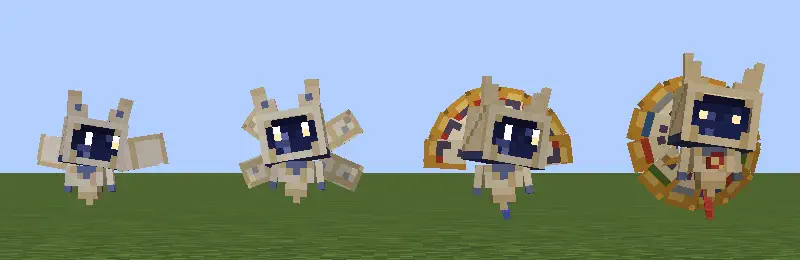
*The four ranks of Star Guest by day, Folio to Duodecimo.*

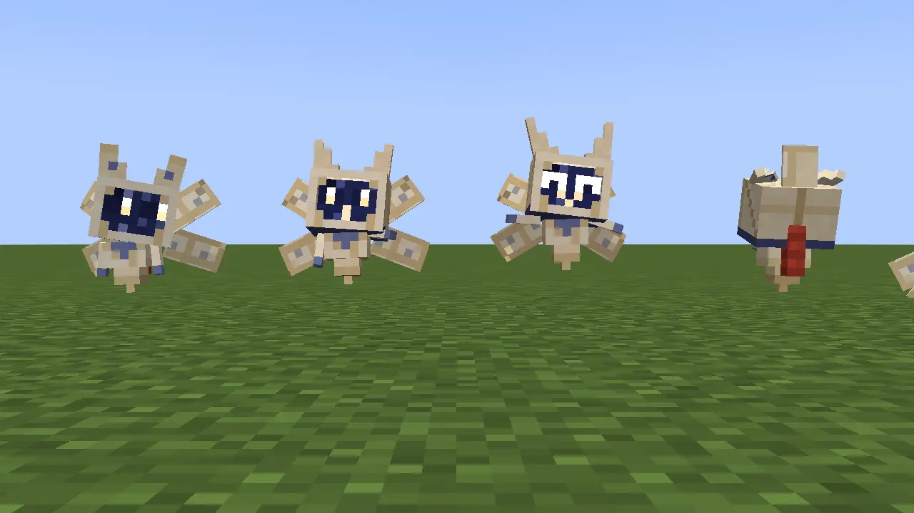
*Four moods of a Star Guest: Curious, Teaching, Delighted and Offended.*

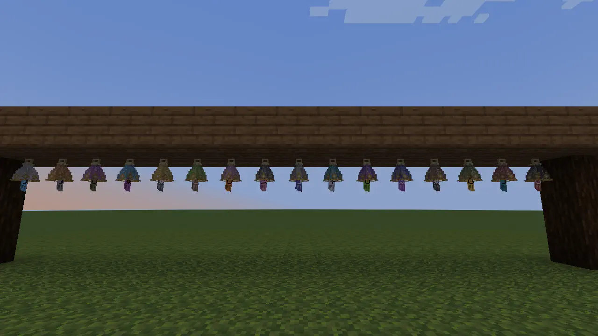
*Star Furin under the eave, with a different colour of glass for each bell.*

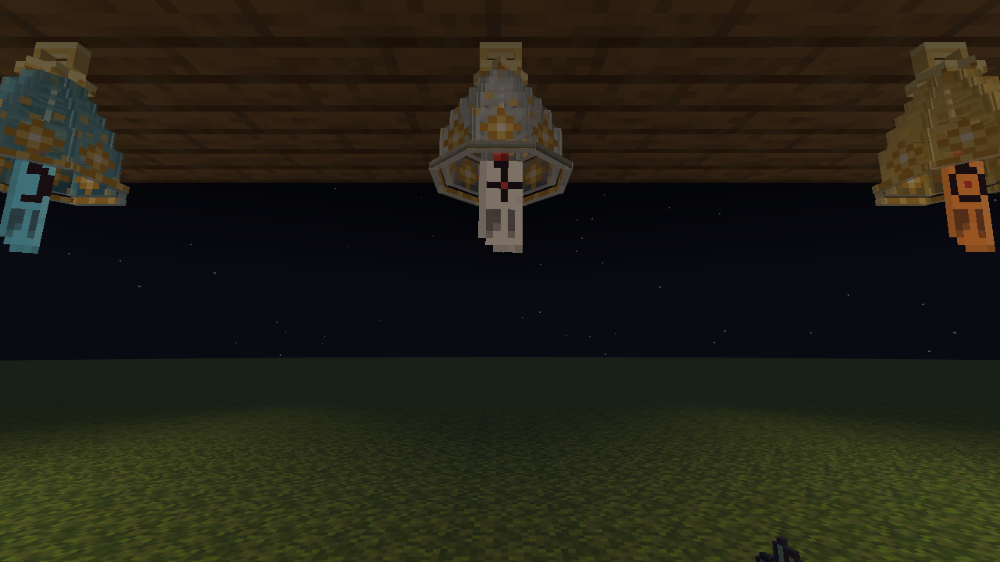
*Star Furin under the eave at night.*

## The workshop

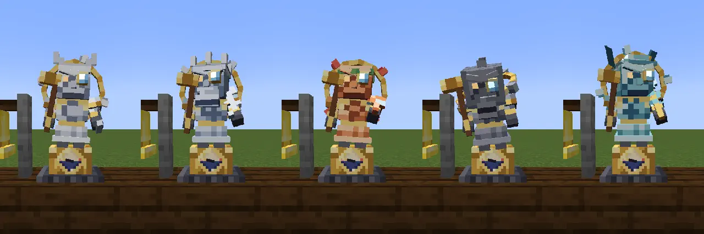
*Five clockwork jacks in five Wanderers' liveries.*

*Three seized jacks, green with verdigris, in front of the woken seven.*

*A Cartouche cut in two, one half for each Mercury jack.*

*A sealed wall after a blast, its missing stones hanging faintly in indigo.*

*The plan complete: a stone house at golden hour, with its supply chests beside it.*

## The Snowglobe

*The inside of a sanctum at the Astral Ward setting, gold lattice glass all round.*

*A whole globe beside a shattered one.*

## The Fool's journey

*The Open House on its hill, grey stone under a copper dome.*

*The Open House's chart room by night.*

*The Grand Reading at the gilded Orrery, the first position and the last.*

## Music disc

***In Good Company*** is the graduation music disc. [Rendition 1](music/in-good-company.ogg) is up for feedback and may change.

## Credits and rights

The cards in these pictures are public-domain art: Pamela Colman Smith's 1909 Rider-Waite-Smith illustrations, the Sola Busca deck of 1491, and Yoshitoshi's *One Hundred Aspects of the Moon*. The screenshots, the music and the words are all rights reserved (see the [licence](../LICENSE)).
